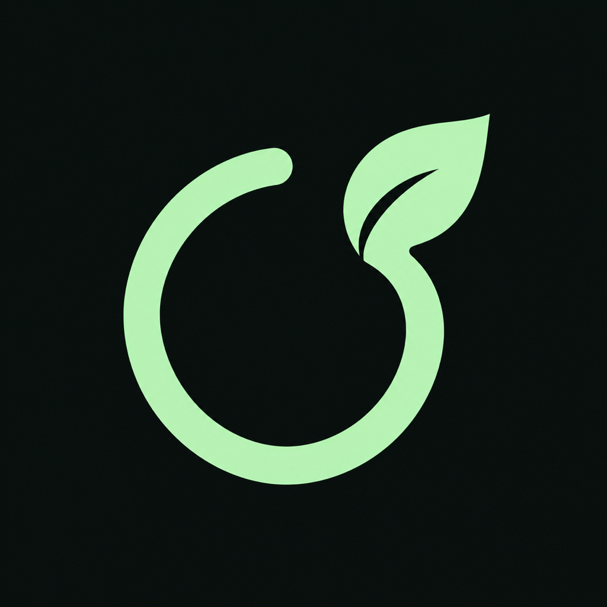

# Lernfokus – Lernzeit für dein iPhone



Native SwiftUI-App für iPhone ab iOS 17. Öffne `Fokus.xcodeproj` in Xcode und wähle das Scheme **Fokus**.

## Aktueller Startmodus: ohne Bildschirmzeit

Der Timer startet ohne Bildschirmzeit-Freigabe und ohne App-Auswahl. Die frühere Sperr-Funktion und das FocusMonitor-Target wurden entfernt. Die beiden verbleibenden Targets benötigen keine Family-Controls- oder App-Groups-Berechtigungen. Sitzungen werden lokal in der Haupt-App gespeichert; ActivityKit übergibt den Anzeigestatus an die Live Activity.

Optional kann „iPhone-Fokus einschalten“ aktiviert werden. Dafür einmalig einen Kurzbefehl **Lernfokus** anlegen: **Datumsangaben aus Eingabe abrufen** (Eingabe: **Kurzbefehlseingabe**) → **Fokus festlegen** (gewünschten Fokus einschalten bis **Zeit**, Datum aus der vorherigen Aktion). Die App öffnet diesen Kurzbefehl mit der Endzeit der Lernphase als ISO-8601-Text. Die Einrichtung ist auch direkt in der App beschrieben. Der persönliche Kurzbefehl muss auf dem iPhone eingerichtet und getestet werden; die App kann seinen Erfolg nicht prüfen. Beim vorzeitigen Abbruch muss der Systemfokus separat im Kontrollzentrum beendet werden.

Ein Systemfokus filtert Mitteilungen; er blockiert keine Social-Media-Apps. Für die Installation benötigen Haupt-App und Live-Activity-Erweiterung eine passende Signierung.

Das geteilte Scheme `Fokus` startet die Haupt-App und baut die Live-Activity-Erweiterung automatisch mit. `FocusLiveActivity` ist keine eigenständig startbare App. Falls Xcode noch eine alte Erweiterungs-Auswahl anzeigt: laufenden Vorgang stoppen, das Projekt schließen und neu öffnen, anschließend oben `Fokus` auswählen. Die Live Activity wird aus einer laufenden Fokus-Sitzung der Haupt-App gestartet.

## Enthalten

- 25 Minuten Fokus + 5 Minuten Pause, 60 Minuten Fokus sowie 50 + 10.
- Eigene, lokal gespeicherte Lernrhythmen (15–180 Minuten Fokus, 0–60 Minuten Pause).
- Optionaler iPhone-Systemfokus über einen selbst eingerichteten Kurzbefehl.
- Timer ohne App-Sperren, gespeicherte Sitzungen und Wiederherstellung beim Öffnen.
- Live Activity auf dem Sperrbildschirm und in der Dynamic Island; Mitteilungen zu Fokus- und Pausenende.
- Vorzeitiges Beenden mit Bestätigung. Jede weitere Lernrunde wird bewusst manuell gestartet.

## Auf dem iPhone installieren

1. In Xcode das Projekt öffnen und bei **Fokus** und **FocusLiveActivity** unter Signing & Capabilities das eigene Team auswählen und „Automatically manage signing“ aktivieren.
2. Eindeutige Bundle-IDs für App und Live-Activity-Erweiterung eintragen. Die Erweiterungs-ID muss mit der Bundle-ID der App beginnen.
3. iPhone verbinden, Entwicklermodus aktivieren, als Ziel auswählen und Run ausführen.
4. Live-Aktivitäten und Mitteilungen erlauben. Die optionale Fokus-Anbindung nach der Anleitung in der App einrichten.

## Technische Grenzen und ehrlicher Teststatus

Die Haupt-App wurde im iPhone-17-Pro-Simulator gestartet und der Startbildschirm per Screenshot geprüft. Simulator- und iPhone-SDK-Build wurden erfolgreich kompiliert. Die Installation auf einem echten iPhone wurde bestätigt. Live Activities und die Kurzbefehle-Anbindung benötigen weitere Gerätetests.

Die angebotenen eigenen Lernphasen dauern 15–180 Minuten. Zeitberechnung und Wiederherstellung verwenden absolute Endzeitpunkte und benötigen keinen dauerhaft laufenden Hintergrundprozess.

Die Live Activity verwendet einen systemseitigen Countdown, der bei null stehen bleibt. Sie zeigt die Pausen-Endzeit separat; ohne erneute App-Ausführung gibt es keinen automatisch umgeschalteten Phasentitel. Eine abgelaufene Anzeige kann bis zum nächsten Öffnen bzw. Entfernen durch iOS sichtbar bleiben. Es gibt keinen Push-Server. Die App erhebt keine Nutzungsdaten und sendet keine Daten an einen eigenen Server.

Die App sperrt keine anderen Apps und benötigt keine Bildschirmzeit-Freigabe.

## Prüfen

```sh
DEVELOPER_DIR=/Applications/Xcode.app/Contents/Developer xcodebuild \
  -project Fokus.xcodeproj -scheme Fokus -sdk iphonesimulator \
  -configuration Debug -derivedDataPath /tmp/FokusBuild \
  CODE_SIGNING_ALLOWED=NO build

swiftc Shared/FocusSession.swift Tests/SessionTests.swift -o /tmp/fokus-session-tests
/tmp/fokus-session-tests
```

Manueller Gerätetest: 25 + 5 starten → iPhone sperren (Countdown) → Fokusende abwarten → Pauseende → App wieder öffnen. Zusätzlich: ohne Pause, Mitteilungen abgelehnt, Live-Aktivitäten deaktiviert, Abbruch, App beenden und neu öffnen, Sitzung über Mitternacht und den optionalen Lernfokus-Kurzbefehl prüfen.

`scripts/generate_project.py` erzeugt das Xcode-Projekt und die Plists reproduzierbar. Bestehende Team-Auswahl, Bundle-IDs, Signierungsidentität und Profilangaben werden übernommen.

## Apple-Dokumentation

- [Family Controls und Distribution](https://developer.apple.com/documentation/FamilyControls/requesting-the-family-controls-entitlement)
- [DeviceActivity: Mindestdauer](https://developer.apple.com/documentation/deviceactivity/deviceactivitycenter/monitoringerror/intervaltooshort)
- [Live Activities](https://developer.apple.com/documentation/activitykit/displaying-live-data-with-live-activities)
